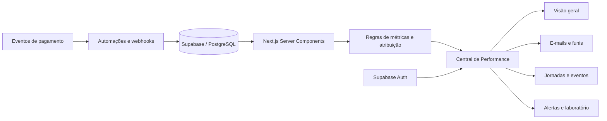

# Central de Performance

[Português](#português) · [English](#english)

## Português

Uma central operacional privada para acompanhar jornadas de recuperação de receita, desempenho de e-mails, eventos, alertas e experimentos em um só lugar.

O projeto transforma dados dispersos de automações comerciais em uma interface que ajuda a responder perguntas práticas:

- quanto foi recuperado e por qual fluxo;
- quais jornadas ainda precisam de atenção;
- onde os e-mails ou links de checkout apresentam problemas;
- como cada etapa do funil está performando;
- quais eventos deram origem a uma conversão.

### Principais recursos

- visão geral com indicadores e séries temporais;
- filtros por período e fluxo de recuperação;
- análises separadas para Hotmart e PerfectPay;
- acompanhamento de jornadas e eventos;
- central de alertas operacionais;
- laboratório para comparar variações de copy;
- autenticação e lista de usuários autorizados;
- cálculos executados no servidor com cache de curta duração.

### Arquitetura



Mais detalhes: [docs/ARCHITECTURE.md](docs/ARCHITECTURE.md).

### Tecnologias

Next.js 15, React 19, TypeScript, Tailwind CSS, Supabase Auth, PostgreSQL, Recharts e Lucide.

### Executar localmente

> Use somente um projeto Supabase isolado com dados sintéticos. Não conecte esta cópia pública ao banco de produção.

```bash
npm install
cp .env.example .env.local
npm run dev
```

Preencha as variáveis descritas em `.env.example`. A chave `SUPABASE_SERVICE_ROLE_KEY` deve permanecer exclusivamente no servidor e nunca pode receber o prefixo `NEXT_PUBLIC_`.

### Segurança e privacidade

Esta versão pública não contém credenciais, arquivos `.env.local`, dados de clientes, mídia real, artefatos de build ou dependências instaladas. Antes de publicar uma alteração, siga [docs/PUBLICATION_CHECKLIST.md](docs/PUBLICATION_CHECKLIST.md).

### Contexto de portfólio

Este repositório apresenta a arquitetura e a implementação da interface. Dados e resultados exibidos em demos devem ser sintéticos. Veja o [case do projeto](docs/PORTFOLIO_CASE.md) e o [roteiro de demonstração](docs/DEMO_SCRIPT.md).

---

## English

Central de Performance is a private operations dashboard for monitoring revenue-recovery journeys, email performance, payment events, alerts, and experiments in one place.

It turns fragmented automation data into an interface that helps operators understand recovered revenue, active journeys, checkout issues, funnel performance, and conversion context.

### Highlights

- overview metrics and time-series charts;
- period and recovery-flow filters;
- separate Hotmart and PerfectPay analytics;
- journey and event traceability;
- operational alerts;
- copy-testing laboratory;
- authenticated, allowlisted access;
- server-side calculations with short-lived caching.

### Stack

Next.js 15, React 19, TypeScript, Tailwind CSS, Supabase Auth, PostgreSQL, Recharts, and Lucide.

### Local development

Use an isolated Supabase project with synthetic data only. Copy `.env.example` to `.env.local`, install dependencies, and run `npm run dev`. Never expose the service-role key to the browser.

This public portfolio copy intentionally excludes secrets, customer data, production media, build artifacts, and installed dependencies.

## License

MIT — see [LICENSE](LICENSE).
