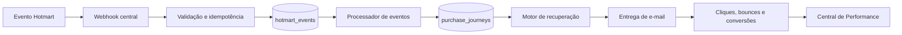
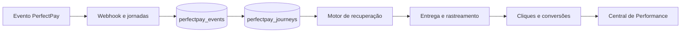
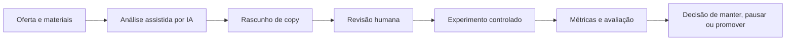

# Fluxos do sistema

## Hotmart

## PerfectPay

## Laboratório de copy

O laboratório mantém revisão humana antes de qualquer promoção. O dashboard consolida as métricas; as automações executam o trabalho operacional; o PostgreSQL preserva o histórico e a rastreabilidade.
